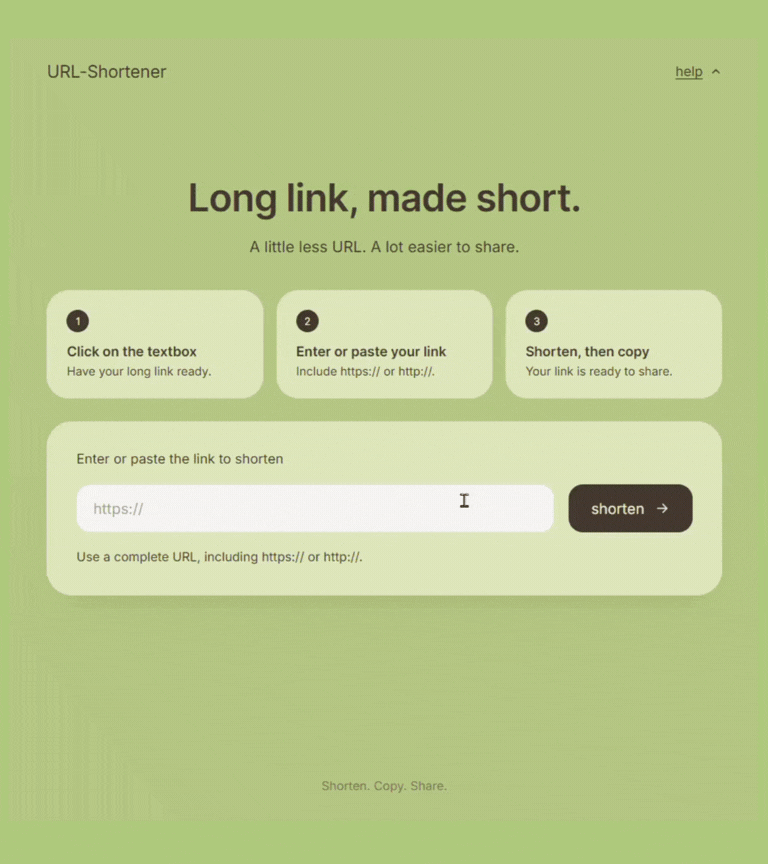
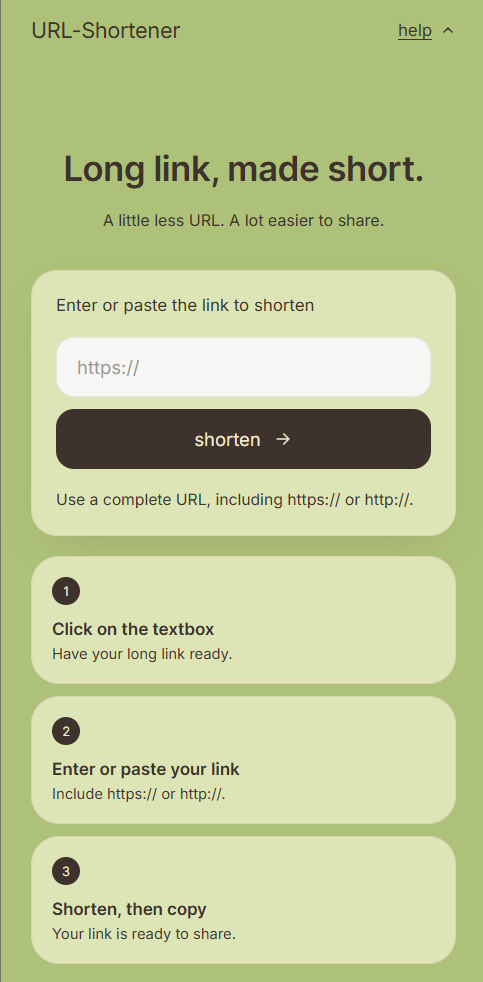

<h1 align="center">URL-Shortener</h1>

<p align="center">
  
</p>

<details>
  <summary><strong>📱 Preview mobile version</strong></summary>
  <br />
  <p align="center">
    
  </p>
</details>

<br />

## Why I built this

I was paying a small monthly subscription for a URL shortener just to share links. It was a minor cost, but it added up for something I use in such a simple way. So I decided to build my own: a clean interface on top of the TinyURL API that does the one thing I actually needed. Paste a link, shorten it, copy it, and share it.

> **Long link, made short.** A little less URL. A lot easier to share.

A minimal URL shortener built with React and Vite, powered by the [TinyURL](https://tinyurl.com) API. Paste a link, shorten it, copy it, and share it.

---

## Features

- **Shorten in one click:** paste a full URL and get a TinyURL link back.
- **Input validation:** invalid links turn the textbox red and show a message underneath. The error clears as soon as you start typing.
- **Shrink animation:** the textbox visibly gets smaller while the link is being shortened.
- **Shorten → copy:** once the link is ready, the `shorten` button becomes `copy`. Copying turns the textbox green and shows a success message.
- **Reset button:** a reset icon slides in next to the textbox after shortening. Pressing it (or the logo) returns the app to its original state.
- **Help section:** the `help` link in the nav reveals three step cards above the input. On mobile they appear below it.
- **Responsive:** the layout adapts to mobile screens.
- **Accessible:** ARIA live messages, keyboard focus states, and reduced-motion support.

## Tech stack

| | |
|---|---|
| Framework | [React 18](https://react.dev) |
| Build tool | [Vite 5](https://vitejs.dev) |
| API | [TinyURL](https://tinyurl.com/app/dev) |
| Styling | Plain CSS with custom properties |

## Getting started

### Prerequisites

- [Node.js](https://nodejs.org) 18 or newer
- npm

### Install and run

```bash
# install dependencies
npm install

# start the dev server
npm run dev
```

Then open the local URL Vite prints (usually `http://localhost:5173`).

### Other scripts

| Command | Description |
|---|---|
| `npm run dev` | Start the development server |
| `npm run build` | Create a production build in `dist/` |
| `npm run preview` | Preview the production build locally |

## TinyURL API

The app works out of the box without an API key. You can optionally add one.

| Mode | How it works |
|---|---|
| **No key** | Uses TinyURL's `api-create.php` endpoint. In development, Vite proxies the request (`/tinyurl`) so there are no CORS issues. |

## Project structure

```
url-shortener/
├── docs/
│   ├── demo.gif        # demo shown at the top of this README
│   └── mobile.png      # mobile preview
├── src/
│   ├── App.jsx         # UI, validation, TinyURL calls, state
│   ├── App.css         # styles, palette, animations, responsive layout
│   └── main.jsx        # React entry point
├── .env.example        # optional TinyURL token
├── index.html
├── vite.config.js      # React plugin and dev proxy
└── package.json
```

## How it works

The app moves through three states:

```
idle ──(shorten)──▶ shrinking ──(link ready)──▶ done
  ▲                                               │
  └──────────── reset / logo / editing ───────────┘
```

1. **idle:** the textbox is empty or being edited, and the button reads `shorten`.
2. **shrinking:** the request is in flight and the textbox narrows. The animation lasts at least 700 ms, even if the API answers faster.
3. **done:** the short link is in the textbox, the button reads `copy`, and the reset icon is visible.

Invalid input is rejected before any request is made. A valid link must start with `http://` or `https://` and have a real hostname.

## License

This project is for personal and learning use.
